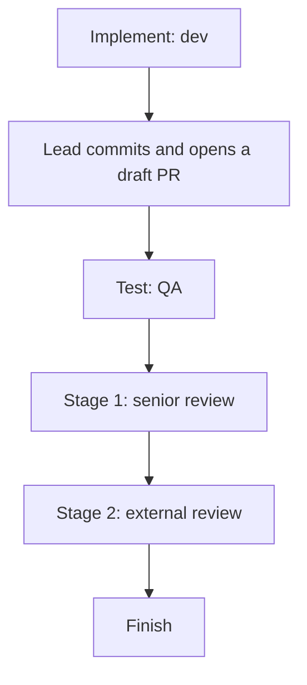

# control-tower spec

control-tower is a taskboard for a team of agents: it says what the work is, how far along it is, and where the owner is needed. It stands on its own; trackers such as GitLab, GitHub and Jira enhance it.

This file is the product spec, and the repo is its one source of truth (owner decision, 2026-11-25). How the dashboard behaves is here; how it looks is the approved snapshots in `tests/snapshots` (section 7). How work is done is in `SDLC.md`; domain words are in `GLOSSARY.md`.

**Status:** built by interview with the owner, section by section. Sections 1 to 4, 6 and 7 are agreed; the message board (3a) is deliberately rough; the UI is set by signed-off designs and approved snapshots (section 7); storage is agreed (SQLite).

**Issue numbers:** `#N` is an issue or pull request in this repo. A decision made before the repo went public (2026-11-16) cites the tracker used then, written "old tracker N", so no number means two things.

**Scope of v0.1.0 (MVP 1):** the basic control-tower: the board and its storage, the `tower` command, the dashboard (the golden UI) and the lead skill. **No external modules:** no tracker import or sync code (GitLab, GitHub, Jira), no ntfy, no server. Items can still carry a tracker link as a plain URL, and agents may use a tracker themselves when an item's standing context tells them to; that is agent behaviour, not product code. Everything modular is on the roadmap.

## Principles

- Start simple. Don't reinvent the wheel or build a ticket system of its own.
- **Modular:** it can be integrated with whichever platforms enhance it (GitLab, GitHub, Jira, a notification channel such as ntfy), either through modules or by telling agents to use the platform's API.
- **Terminal-neutral** (owner decisions, 2026-11-20 and 2026-11-23, #8, #86): control-tower is its own product. Its core (the board, the watch, live delivery, the lead-listening check, the hooks, the dashboard) never names a terminal; it reaches the terminal through one built-in module. Rex is the one terminal module; herdr was removed in 0.6.0. Another terminal (herdr-core, #2) is a new module, with no change to the core.
- **The interface answers "where are we" by existing.** There is no dedicated "where are we" feature: the views are intuitive enough that the current state is obvious at a glance.

## 1. The board

- control-tower is the taskboard: it says what the work is.
- It holds **repos**, **milestones** and **tasks** (owner decision, 2026-11-05). A repo is a git repository, named by its main checkout and carrying its forge link. Every milestone and every standalone task belongs to one repo. A task sits under a milestone or stands alone in its repo. An item may be without a repo only as a transitional state (a board upgraded from before repos), until it is given one (lead decision, 2026-11-05).
- A task can have **subtasks**, one level only. If a subtask needs its own subtasks, it goes back to the lead, who creates new tasks if needed.
- Each item can carry:
  - a small amount of **standing context** ("when picking this up, do ABC"), which belongs to that item only;
  - for a task: its **description** (what and why) and **acceptance criteria**, copied from the ticket when it is added (for example from `/to-tickets`), plus what it is **blocked by**;
  - a **link to its ticket in whichever tracker it came from** (GitLab, GitHub, Jira or another). For example, the owner can send a lead to pick up a Jira ticket, draft a spec and start workers.
- **Who adds items:** the owner adds items; leads can add items too; workers can propose items to their lead, and the lead decides.
- The owner starts one lead per repo, and leads start workers. The board doesn't start anything; it's what they read when they pick work up.

## 2. Stages and progress

- **Task and subtask stages:** Waiting, In progress, Done.
- **Milestone stages:** the same three, plus a goal and a percentage done.
- **Goal:** every milestone carries a one-line goal on the board. If the milestone links to a tracker milestone, the goal can be copied from there when the item is created; after that, the board's line is what counts.
- **Progress:** control-tower works it out from its own board, by one rule:
  - milestone % = done tasks ÷ all tasks under it;
  - subtasks don't count separately: a task shows its own "3/5 subtasks";
  - trackers don't supply the numbers. They're where items come from: once tasks are brought onto the board from GitLab, Jira or a todo list, the percentage follows.

## 3. Who does what

- **The owner is the manager** of several dev teams. They:
  - add items, either directly or by asking an agent ("add this milestone to the tower board");
  - start leads;
  - follow along and track progress on the board;
  - talk to leads, including for confirmations.
- **One lead per repo** (owner decision, 2026-11-05, replacing "one lead, one milestone"). The problem it solves: several leads per repo did not coordinate, issues they raised went unclaimed, the owner was the only messenger between them, and every lead was another session in the owner's panes and on the laptop. The repo's lead:
  - owns the repo's backlog and all its milestones and standalone tasks, and runs the workers directly;
  - coordinates the team and makes decisions on the owner's behalf;
  - makes sure no worker is blocked and the work gets completed;
  - coordinates with the owner and within the team; it is the only session that writes to the owner about its repo;
  - on the board: splits milestones into tasks, assigns tasks to workers, moves tasks between stages, marks milestones Done;
  - **coordinates, never does the work itself.** Implementing, testing and reviewing are done by the team.
- **What the lead decides and what stays the owner's** (owner decision, 2026-11-05):

  | Area | The lead | The owner |
  |---|---|---|
  | Triage | Bugs: labels them ready-for-agent or needs-info, closes duplicates with a link | Features (new, changed, rejected) and wontfix: the lead asks once, as a need-you item |
  | Picking up work | Takes ready-for-agent work without being told | |
  | Order | With release milestones, release by release first; then blockers first, then bugs before features, then oldest first; the order is shown on the board | A `priority` label on an issue runs it first |
  | Merges | As the repo's SDLC says (see Finishing) | As the repo's SDLC says |
  | Releases | With the owner's permission (the repo's SDLC or standing context), cuts the release itself; otherwise proposes one | The go, unless given to the lead |
  | UI | Builds only to a signed-off design | Signs off the design before it is built; approves the change's new and changed snapshots in its PR before it merges |

- **Sub-leads by exception only** (owner decision, 2026-11-05). A lead may decide to start a sub-lead for a piece too big for its own context. The sub-lead reports on the repo's board like a worker. The board has no support for sub-leads until one has been used.
- **No session cap** (owner decision, 2026-11-05: no magic numbers). Two rules keep the session count down: a worker starts only when it has something to act on, and a finished worker is closed when its step is done, unless it gets the next step straight away.
- **Leads do not use `/goal`** (owner decision, 2026-11-02). `/goal` keeps Claude working turn after turn until a condition is met, judged only from the conversation; a lead waits on the owner (reviews, merges) by design, so a goal would keep it busy for nothing. The board is the goal: the lead re-reads it, and a milestone is Done when every task under it is Done, by the same rule as the percentage.
- **The repo first** (owner decision, 2026-11-02). A lead runs on its repo's main checkout and registers on that repo; a new project gets its repo before any worker starts. Its workers run in its own Rex session, never in another one (since 0.6.0: #86, #113).
- **A lead's life** (owner decision, 2026-11-05). The owner starts it on the repo's main checkout: from the dashboard (`n`), which opens a new Rex session named after the lead (owner decision, 2026-11-20, #86), or in a session of the owner's own. A milestone reaching Done does not end it. With no work left it stays running, waiting for new issues. Several leads on one repo give way to one as their milestones finish: current leads finish and are closed, and the repo's lead takes what is left.
- **Workers** (implementers, testers, reviewers):
  - are visible sessions in their lead's Rex session (#86, #113): an implementer in a tab of its own, on a git worktree beside the repo's main checkout; a tester or reviewer as a pane in its implementer's tab;
  - are each a Claude session the lead names with `claude -n <name>`: that name is the task's assignee, the board author and the @mention handle (owner decision, 2026-11-20, #86; the name's form, #92);
  - post progress and updates on the board;
  - can set their own task to Done; the lead can push back.
- Helper agents (the Agent tool, in the background) are separate from workers.
- **Messages go through the board** (see 3a).
- **Closing a milestone:** the lead can mark it Done without waiting for the owner, but once it does, it checks in with the owner.

**Come back to this:** multi-repo projects are parked (owner, 2026-11-05: "a problem for later"). The model does not block them: each repo has its lead, and the leads coordinate by posting on each other's boards. Design it when the first real multi-repo project needs it.

## 3a. The message board

Deliberately rough: don't design further until there's real use.

- Each repo has one message board: the team's group chat (owner decision, 2026-11-05: the board belongs to the repo, so its history survives a lead being replaced). Communication to the team, and each team member's communication, goes here while work is going on. Everything is on it for the owner to read, and it reads as a group chat (UI v0.1.7, section 7).
- Conversations are **threads**, opened for whatever comes up (a problem, a question, a decision). Each task team also has its own thread. A thread links to a task, to a milestone, or to neither (repo-wide, for example triage). One conversation per task: the watch's flags about a task sit in that task's thread.
- **Threads read in words** (owner, 2026-11-05: "`T29 #101 build` doesn't mean much to me"). A task's thread shows its task's title, stage and who is on it; ids come last. Any other thread is named after what it is about, never after an id.
- **Lead to lead:** a lead posts on the other repo's board, never by `SendMessage`.
- **The owner's pane** (owner decision, 2026-11-05, old tracker 87). A lead answers board posts on the board. It writes in the owner's pane only when something changed for the owner (a decision, a task done, a blocker, a failure, a question), and then it writes the full current state, so the latest message in the pane is always the whole picture.
- A thread has a title, who started it, a status (such as RESOLVED), a reply count and a time. Replies sit under it, each with its author and time.
- Team members **acknowledge in words** ("copy"), not with emoji.
- Resolving something comes with evidence (for example "search back to normal, 1,284 queries in 5 min, p95 at 180 ms").
- A board can have categories (the owner's sketch shows "#ops-board › Incidents").
- **Needs the owner:** a question to the owner (a need-you message, below) puts the message on the owner's "needs you" list and sends a phone push.
  - In v0.1.0 the phone push is Claude's own push notification, sent by the lead; modules (ntfy and others) enhance it later (owner decision, 2026-11-02).
- **The owner's handle is `@manager`,** matching the team model. It is configurable (long term), so the owner can pick another handle; `@manager` is the default for now.
- **Two kinds of @manager** (owner decision, 2026-11-05, old tracker 113): the lead tags what needs the owner; everything else addressed to the owner is for their awareness.
  - **A mention** is what the board reads as one, for delivery and alerts alike: `@manager` in a code span, a fenced block or a line starting with `>` is quoted, not a mention. A name followed straight by `(` and an ASCII character or the end of its line (`@cart(x)`), or by `.` and an ASCII letter, digit or `_` (`@cart.isEmpty()`), is code, not a mention, while a sentence ending on a name (`@qa.`) still mentions it (old tracker 84). A name before `.` or `(` and a character that is not ASCII, such as Chinese or Japanese (`请@qa.谢谢`), is a mention (#48), and so is an `@` right after a letter that is not ASCII; one right after an ASCII letter or digit, as in an e-mail address, is not (#41).
  - **Needs you:** a message that starts with `question:` and mentions @manager: a question or approval that waits on the owner. Tower's own post about a worker waiting on a prompt in its terminal is one.
  - **For your awareness:** any other message that mentions @manager: answers, reports, replies, a lead's `decision:` about a decision it made on the owner's behalf, a delivery failure (below). It doesn't block anything.
  - **Need you** items stay on the alert line until the owner clears each one (`r` on the item in the inbox) or their thread is resolved. A click or Enter on the item opens its thread, which does not clear it: a question seen is not answered.
  - **For your awareness** items leave the alert line and the inbox when the owner opens their thread (which marks them read), marks them read (`r`), or their thread is resolved; they stay readable in their thread (owner decision, 2026-11-06, old tracker 140). Opening a thread means the full board shows it: the one the owner picks, or the first thread when `b` opens the board with none chosen. A read that fails is tried again a couple of seconds later (old tracker 121).
  - **No post clears another:** a reply, from the owner or anyone, changes no item's state.
  - **Counting is by message:** each @manager message is one item. A lead asks once: it never re-posts "I still need you for the above"; one post is enough.
  - **A delivery failure is for your awareness, not need-you** (owner sign-off of UI v0.1.7, 2026-11-05): it is not a question for the owner. A failure to a name no worker on the board has had (no task's assignee, no post's author: a quoted example such as `@name` or `@Override`, or a misspelling) is the author's to fix, not the owner's: tower replies on the post's thread to its author, and the owner gets nothing (old tracker 145). A failure to a known worker that is gone stays the owner's item while the worker can still need the post: it is the assignee of a task not done, or a post in the send is less than an hour old. An older send to a gone worker with no such task is a closed worker's, found by a watch catching up after a stop: it is logged only, with no item (#128). A send to a worker the terminal lists goes however old the post is.
- **Comms module (later):** a notification channel such as ntfy can be plugged in as a module.

## 4. Work mechanics

### Starting

- **When a lead starts:** it reads the brief and checks the linked tickets or work items, then the repo's issues: it triages new ones and picks up ready-for-agent work in its order (see section 3), and posts that order on the board.
- **What it does next depends on what already exists:**
  - **No analysis yet:** it gathers enough context to know what to do, then sends out researchers and analysis agents.
  - **Analysis done and spec written:** it builds tasks under the milestone from the spec.
  - **Spec and tasks exist:** it dispatches the relevant workers across the tasks.
- **The general loop:** get context, work out what needs doing, work out the order it can be done in (unless the spec already sets it out), dispatch workers.
- **Where it talks:** with the team on the message board. While no team communication is needed, the lead talks with the owner in its own session.
- **Spec and tickets:** a new goal or milestone gets a spec and tickets, signed off by the owner, before building starts. `/to-spec` and `/to-tickets` are the owner's to run, in the lead's own session: `/to-spec` turns the current conversation into a spec without an interview, so it must run in the session holding the context; a fresh session would write from guesswork. Later, control-tower can be the tracker those skills publish to, so tickets become the milestone's tasks directly.
- **Helpers are read-only by default** (owner decision, 2026-11-02): they look and report; changing code or systems is a worker's job.
- **A worker's brief** gives it everything it needs to complete the task, all relevant information but no unnecessary context (owner decision, 2026-11-02).
- **A lead registers itself** on its repo (`tower lead add`) as its first step, since only it knows its own Claude session name (owner decision, 2026-11-02; on the repo since 2026-11-05).
- **A task's MR line** is updated by the lead whenever it opens, updates or merges the MR (owner decision, 2026-11-05: the lead opens the PR).
- **Researchers and analysts are helper agents by default:** their findings go straight back to the lead, they run in parallel, and they need no worktree, trust prompt or extra session. A visible worker is used when analysis is long (more than about half an hour) or the owner may want to watch or steer it (for example testing against a live system).
- **Helpers stay visible through the board:** the lead posts when helpers start and finish and what they found. A helper that hits a wall (refused access, a missing tool) stops and reports instead of working around it, and the lead raises it on the board.

### While work runs

- **What workers post:** a short plan before building, a progress line at each step, then "done" with the test output and the reviewer's verdict.
- **Spotting a stuck worker:** the worker says so, and control-tower also flags it by fixed rules; the lead decides what a flag means.

  | Signal | Detected by | Goes to |
  |---|---|---|
  | Waiting on a prompt (permission, question, credential) | the terminal shows the worker blocked (in Rex, its program status) | the owner and the lead at once (only the owner can answer it) |
  | Says it is stuck | worker posts "blocked: ..." | the lead, who @mentions the owner if it can't resolve it |
  | Stopped without reporting | session idle or finished, task not Done, no post for 5 min | nudge, then the lead |
  | Silent while working | task In progress, worker busy, no post for 30 min | nudge, then the lead |
  | Orphaned | task In progress, the worker's Claude session gone from the terminal | the lead |

  - **Nudge first:** for the stopped and silent signals, control-tower nudges the worker directly ("no post for 30 min, post your status"). If nothing comes within 2 minutes, it flags the lead, who acts as it sees fit (nudge again, reassign, escalate).
  - Flags are system messages in the task's thread on the repo's board, so they are on the record.
  - The owner is only pulled in for prompts only they can answer, or when the lead @mentions them.
  - Loop detection (a worker retrying the same failure) is left out until real use shows it's needed.
- **How posts reach a lead** (owner decision, 2026-11-05, old tracker 87; the waiter, old tracker 146). The lead runs a board waiter, `tower lead wait <R>`, as a background command: it ends only when a post on the repo's board is unread, and its end wakes the lead, which reads with `tower lead unread <R>` and arms the waiter again in the same turn. It has no timer, so an idle lead is never woken for nothing. A Stop hook is the backstop: it stops a lead ending its turn with unread posts. The watch raises "Lead not listening" for a registered lead with no waiter running: once its Claude session is gone from Claude's own session list; once it is idle having ended a turn with no waiter (each such turn counted by its Stop hook, or by its StopFailure hook for a turn that ends on an API error); or once it has gone 5 minutes without attaching. It never asks the terminal (owner decision, 2026-11-20, #86).
- **How posts reach a worker** (owner decision, 2026-11-24, #111: "I don't want typing direct into session, lets try relay and make sure that our logging is comprehensive enough we can analyse for bugs as we use it"): the watch delivers them live to the worker's Claude session by name, as a message from `@control-tower`. tower cannot use Claude Code's cross-session messaging itself (#108), so each send goes through a relay: a headless Claude session named `control-tower` that sends the text with its SendMessage tool and nothing else. Nothing is ever typed into a worker's terminal, nothing is sent to a worker at a prompt, and every send is logged in full so the relay can be checked in use.
- **An idle lead hears its forge** (old tracker 159) through a forge waiter, also run as a background command: it polls every five minutes and ends only when it finds a change (issues, pull or merge requests, reviews, approvals, merges, pushes, branches, tags, failed default-branch pipelines). This is the lead's own `gh` or `glab` loop, not product code, so it keeps the rule of no tracker sync code.

### A task's process

- **A repo's SDLC wins where it covers something** (owner decision, 2026-11-05). A lead follows the SDLC of the work's repo (for example `SDLC.md`) for anything it covers: steps, gates, merge rules, releases. Where it says nothing, the default lifecycle below applies. How a lead works (the board, threads, workers, the gate, @manager) is always this spec's.
- **The default lifecycle** (owner decision, 2026-11-05) is control-tower's own lifecycle, from its `SDLC.md`, which the lead skill carries as its default lifecycle for any other repo; `SDLC.md` says how the two copies differ and that a change to one is checked against the other.

- **The steps and their rules** (Implement, Test, Stage 1 and Stage 2; the hand-off, a partial one included (owner decision, 2026-11-05: "I have done A and B, please test them while I do C"); Build once per change (owner decision, 2026-11-09, old tracker 147); findings, the PR, sizing and work items) are `SDLC.md`'s for control-tower, and the lead skill's default lifecycle for a repo whose SDLC does not cover them. This spec does not restate them.
- **What the board adds** (how a lead works, always this spec's): each step reports to the lead, who starts the next step on the board. A Light change may go to subagents instead of visible workers; its task then needs no assignee, which is the gate's one exception (owner decision, 2026-11-05). The lead tracks those subagents itself, since the watch does not see them, and posts their results on the task thread.

### Finishing

- **A task that is part of a larger MR** waits until every task that MR needs is done; a standalone task finishes on its own.
- **MR into a working branch** (the ticket's or integration branch): the lead merges it, then marks the task Done.
- **MR into master or main: the owner's gate by default** (owner decision, 2026-11-05). The lead takes the MR out of draft and asks the owner, as a `question:` post that mentions @manager, to review and merge it; the owner does peer review and merges. A repo's SDLC, or a milestone's or task's standing context, can give the lead that merge (control-tower's `SDLC.md` does).
- **Waiting on the owner's merge, by scope:**
  - the "merge" task or subtask is created during spec and ticketing, before work starts, so progress never shows 100% while the owner's review is pending;
  - in a milestone, the merge is its own task: every other task can be Done while the "merge" task waits;
  - in a task with subtasks, the merge is its own subtask, in the same way;
  - a task with no subtasks stays In progress until it is merged.
- **A finished worker is closed when its step is done,** unless the lead gives it the next step straight away (owner decision, 2026-11-05; this replaces keeping workers while their context is worth more). The implementer is the exception: it and its worktree stay until its PR is delivered (merged, or handed to the owner or the named reviewer to merge), since the tester and the reviewers work beside it and a fix from any step is made in its worktree; its hand-off folders are removed when the work is done. Before the lead closes the last worker on a task whose next step has not started, it unassigns the task, so a post on the task's thread is never sent to a worker closed on purpose (old tracker 141); a lead is never a task's assignee. Once a task is Done, the lead's posts in its thread reach its worker only by @mention. A started task stays In progress, blocked with its reason when it is waiting on something (a pipeline, a review); it does not go back to Waiting (owner decision, 2026-11-05, old tracker 100).

## 5. Gates and quality

Covered by section 4 (the task process and finishing).

## 6. External trackers

- **Different purposes, so a copy is not a split brain:** the tracker item (GitLab, GitHub, Jira) is the request, the record and the ticket; control-tower is the delivery of it. Each is authoritative for its own purpose: the tracker for what was asked, control-tower for how it is being delivered (tasks, stages, progress).
- **Into the board:** adding an item from a tracker copies it, including its child items as tasks or subtasks, plus the link back. After that the board may grow more tasks than the tracker has; that's fine.
- **Back to the tracker:** nothing is automatic. The lead updates control-tower; it updates an external tracker only when the item's standing context says to, or when the owner asks or approves. Automatic updates happen only where the owner has set that up.
  - **The repo's own forge is the exception** (owner decision, 2026-11-05, section 3): the repo lead triages the repo's issues there (labels, release milestones, duplicates closed with a link, issues filed for bugs and follow-ups) and records outcomes on them, as its repo's SDLC says.

## 7. The owner's view

### How the UI is set (owner decision, 2026-11-25, #122)

- **The reference is the product, not a prototype.** This spec says how the dashboard behaves; the approved snapshots in `tests/snapshots` show how it looks, rendered by the real code with invented data. Both are reviewed in PRs. No prototype is kept in the repo.
- **A UI change starts with a design the owner signs off:** a prototype (an artifact linked from its issue) showing only the change, with invented data (no real board, host, project or person). The change is built to it. The owner approves its new and changed snapshots in the PR, and from then on the snapshots are the reference: the prototype is not consulted again. `SDLC.md` says how.
- **Where a prototype and the terminal differ** (a browser's line breaking, font sizes), the snapshot the owner approved is what counts. The prototypes used smaller text for times, tags and events; the terminal has one font size, so the build shows them in dim colour.
- **Signed designs**, one row per signed-off design, the sign-off record (the prototypes themselves are not kept):

  | Version | Approved | What it set or changed |
  |---|---|---|
  | golden v0.1.0 | 2026-10-30 | The reference for MVP 1: its layout E (Combined); layouts A to D in it were rejected alternatives. |
  | v0.1.3 | 2026-11-02 | 13 changes: no duplicated title, titles wrap instead of being cut, stage columns sized to their content, the message board takes the remaining height, a readable goal line, every card shows its assignee line. It also opened the dashboard in its own herdr workspace (`prefix+a`) and as a popup at 85% (`prefix+A`), which went with herdr in 0.6.0 (Rex: #85). |
  | v0.1.4 | 2026-11-02, old tracker 48 | The fold: left and right fold and unfold, `z` for all, the fold mark clickable; a folded row keeps its lead markers, bar and % plus one summary line with !N for blocked; folds persist on the board. |
  | v0.1.7 | 2026-11-05: "Yes I'm happy with this UI design" | 35 changes. One lead per repo: the tree is repo, then milestones, then standalone tasks, then a folded Done group per repo (old tracker 90). The message board belongs to the repo and reads as a group chat: bubbles in role colours, the owner on the right, a run from one person in one bubble, long messages folded behind "read more", acks as small replies, system events as quiet centred lines, a pinned "Needs you" strip, threads titled in words with a "where it stands" line. It also takes in old tracker 53: a calmer tree, one-line cards, a short alert line. |
  | v0.1.12 | 2026-11-09, old tracker 140 | On the full board, open threads keep their three lines and RESOLVED folds into one row, "RESOLVED N ▸", unfolded with → or a click, each resolved thread then one line (✓ title, age). The inbox shows only NEED YOU and FOR YOUR AWARENESS. |
  | v0.1.13 | 2026-11-13, milestone v0.4.0: "signed off, with the recommended answers" | A URL in a message stays whole on its own line, breaking only after `/ ? & -`, is one clickable link, and the tags and age move to the name line (old tracker 150). Typing writes on an open thread: clicks never stop writing, focus is visible, every letter key goes to the draft (Esc first for a key command), Alt+Enter is a new line, the input grows to four lines (old tracker 151). Bubbles take 85% of the conversation, capped at 100 columns of text; long thread names wrap (old tracker 152). Two lines per open thread, blank lines between threads and before groups, room under Needs you and the thread header, each later message's age line in place of the dashed rule (old tracker 153). The tree, the thread list's status line and the thread header show the ticket from the tracker link, not tower's id (old tracker 154). The overview and detail boards fold resolved threads (old tracker 156). Same-titled resolved threads carry their own title as a suffix (old tracker 157). In a narrow pane the full board lists one line per thread, up to half the pane (old tracker 158). Keys lines offer only what works (old tracker 162, 164); the wheel moves the inbox selection with the view (old tracker 166). The dashboard's "hand to a lead" is removed (old tracker 116). |
  | v0.1.14 | 2026-11-23, #90: "approved all" | A message keeps its first line's indent: the composer drops only leading blank lines and the spaces that end it (#16). A leading `decision:` is bold in the info colour only on a message for your awareness, in bubbles, where it stands and the inbox, and plain on any other (#53). Tower's own question for the owner draws in the chat with a "needs you" tag and without its `question:`, while where it stands keeps `question:` (T41, #68). A URL is split at its break points before it is escaped, so an `&` in it draws as `&` and never as `&amp;` (#90). |

### Errata: where a signed design is wrong, the spec wins

1. A task's detail also shows its **standing context** and **tracker link**.
2. **For your awareness** items drop off the alert line and the inbox when their thread is opened or resolved; they stay readable in their thread (see 3a; old tracker 140).
3. The **newest** alert is the latest by time.
4. A milestone with **no tasks** is never shown as done.
5. With nothing waiting, the alert line says **"nothing needs you"** instead of "0 need you · 0 for your awareness".
6. **Reply counts** exclude the opening message; a thread's **age** is the time of its latest message.
7. **"Hand to a lead"** is the command line's `tower task hand`; the dashboard has none (v0.1.13 removed it).
8. Threads are **linked to their task** by a stored link, never by matching titles.
9. **Need you** is only a `question:` message that mentions @manager; every other @manager message is for your awareness. The prototypes' sample questions carry no tag (such as "@manager please confirm the merge order" in v0.1.7's "Needs you" strip); the build reads them as need-you only with `question:`. A need-you item clears only when the owner clears it or its thread is resolved (owner decision, 2026-11-05, old tracker 113; see 3a). As built since 0.1.8: `r` clears, and a click on the item opens its thread (lead decision on old tracker 113, for the owner to confirm).

### Behaviour decided after the review

- **Only the owner acts as `manager`** (owner decision, 2026-11-02): posting as `manager` and marking inbox items read are impossible from the `tower` command line; only the dashboard can do them. Agents are not told this; they simply cannot.
- **Posting from the dashboard:** the owner posts as `manager` from the composer. The dashboard writes the post itself, through the same checked write `tower post` makes, so every write still goes through the same checks.
- **Blocked is a flag on a task,** set and cleared by the worker or lead through `tower`. The tree's "!" and the lead's "N blocked" both come from it. A worker waiting on a prompt in its terminal also shows as a need-you item.
- **Thread to task:** a thread stores the task it belongs to.
- **Milestone stage:** shows In progress automatically once work starts; Done is set by the lead, only when every task is Done.
- **Task Done guard (lead decision, 2026-11-01):** a task cannot be Done while any of its subtasks is open, so a waiting merge subtask keeps it below complete; reopening a subtask moves a Done parent back to In progress.
- **A task's "doing" line** is the worker's latest progress post on that task.
- **Navigation:** Esc always goes back to where the owner came from (including inbox to thread and back); `q` or Ctrl-C closes the dashboard.
- **Where the dashboard runs** (owner decisions, 2026-11-20 and 2026-11-23, #86): `tower ui` in a Rex tab.
- **The dashboard's keys in Rex** (#85; owner decision, 2026-11-25: Remote Control stays off). Rex has no plugins, so the keys are two actions in a Lua file the repo ships (`rex/control-tower.lua`) and brew installs with its prefix written in; the owner loads it from their own `init.lua` and binds the keys. Each action runs `tower space` or `tower popup` with the session and block the key was pressed in.
  - **The dashboard's tab** (`tower space`): pressed outside the dashboard's tab, it shows that tab, the key's own session searched first, and opens one in a new tab of the key's session when there is none. Pressed in the dashboard's tab (any pane of it), it goes back to the tab it was last pressed in outside it. `q` in the dashboard's tab only closes the dashboard; it never goes back.
  - **Found by asking Rex, never by its label:** `tower ui` in a tab of its own (not the popup), and only in Rex, names itself and its board in its root program status record, as the app `control-tower-` plus the first 8 hex digits of the SHA-256 of the board's canonical path (22 bytes; Rex ignores an app over 32), cleared when it closes. A block is a dashboard of the key's board while that record's app is the key's own board's and its owner is the block's foreground process, by pid, and by name when the record names one, since a record outlives its program. A dashboard of another board is passed by. Pressed in a tab holding any dashboard of its board, the key counts as pressed in the dashboard.
  - **When the key fails:** another block or session Rex cannot read during the look (a tab closing) is passed over and logged. The key fails, saying why and moving nothing, when Rex cannot list its sessions, the key's own session or block cannot be read, the look runs past its 15 seconds, the back file or its folder cannot be written, or the new tab cannot be opened. The popup fails when the key's session cannot be listed, its block is in no tab, or the layer cannot be opened.
  - **The back file** beside the board (its name with `.space-back` in place of its extension) holds the one place the key was last pressed outside the dashboard, as JSON: its Rex session and window. The key makes its folder when there is none yet. With no back file, one that cannot be read as a place, a place Rex no longer has, or one in a session Rex could not list, the key from the dashboard moves nothing: `tower space` prints `{}` and the reason on stderr, which Rex logs.
  - **The popup** (`tower popup`): the dashboard in popup mode in a floating layer over the key's tab, 85% of it each way and focused; `q`, or Esc at its top level, closes it, and the layer goes with its block.
  - **Nothing outside a key press moves the Rex app:** tower only answers the key's action, which asks the app to show the place (`session.select`), so Rex's Remote Control is never needed and tower never asks for it.
- **Keyboard parity:** every mouse action has a key: `c` writes a message, PgUp and PgDn scroll, up/down and Enter work in the inbox.
- **Clock:** the header shows the real local time.
- **Progress:** the percentage rounds down, and the bar uses the same rounding.
- **System messages:** stuck-worker flags and nudges are posted as a distinct `system` author with its own style.
- **Terminal translation:** hover becomes the selected row plus a hint line; mouse click and wheel are supported where the terminal passes them to the pane; colours fall back for terminals with fewer colours; the ⚠ and ⓘ glyph widths are checked in the terminal; in narrow panes the stage columns stack or truncate.

### The view

- **The focus is a TUI in a terminal tab,** grown in whichever direction makes sense with use.
- **It shows the current state, plus alerts from the message board.** No "since you last looked" history.
- **Picking a milestone opens both** its tasks with their stages and the repo's message board, narrowed to that milestone's threads. Picking the repo shows its whole board.
- **Every milestone and task opens into a detail view,** because a one-line title doesn't say what it is:
  - milestone: goal, standing context, tracker link, the spec it came from, its lead and team, its tasks with stages, the message board;
  - task: description, acceptance criteria, blocked by, who is on it, subtasks as a checklist, standing context, tracker link, MR and pipeline, its thread.
- **Standalone tasks** (no milestone) are their own group, shown like a team: each with its assignee or lead and subtask count, opening into the same task detail; `tower task hand` hands one to a lead. Selecting a standalone task shows its detail straight away, since there is no milestone overview above it.
- **Alerts take one line, never more:** "⚠ N need you · ⓘ N for your awareness" with the newest need-you item. Clicking it opens an **inbox** listing every item (need you first), each opening its thread. Each lead in the tree shows its own counts as badges.
- **The layout of the views is set as section 7 says** (How the UI is set): a design the owner signs off, then the snapshots the owner approves, rendered by the real code.

## 8. Storage

- **One SQLite database per machine**, written only through a `tower` command. Agents never touch the file directly; the command checks every write and refuses a bad one loudly. The dashboard reads the same file.
- Agents use the command from the shell, as the lead skill teaches them (for example `tower task stage 12 done`, `tower post <thread> --by qa-2 "copy, testing now"`, `tower milestone show M2`).
- **Each machine has its own board.** The phone gets pushes (Claude's own, or ntfy), not the board.
- **A server later, if it grows:** for one board across machines or a phone view.

## Roadmap

- Adding items (milestones, tasks) from the dashboard; for now they are added through `tower` or by asking an agent.
- A configurable owner handle (default `@manager`).
- Message board categories.
- Multi-repo projects (see section 3): one lead per repo, coordinating on each other's boards.
- Support for sub-leads on the board, once one has been used.
- **Modules (all of them):** tracker import and sync for GitLab, GitHub and Jira (section 6), notification channels such as ntfy (section 3a), and other terminals beside Rex (herdr-core, #2).
- A server for one board across machines or a phone view.
- A macOS menu bar app (to investigate): turn the watch on and off, and see a few stats (needs you, blocked, milestone progress) outside the terminal. The watch runs as a `brew services` background service.

## Next

What is planned next, and in which release, is the repo's GitHub milestones and their issues: <https://github.com/daderoode/control-tower/milestones>. Multi-repo projects (section 3) are still to come back to.
